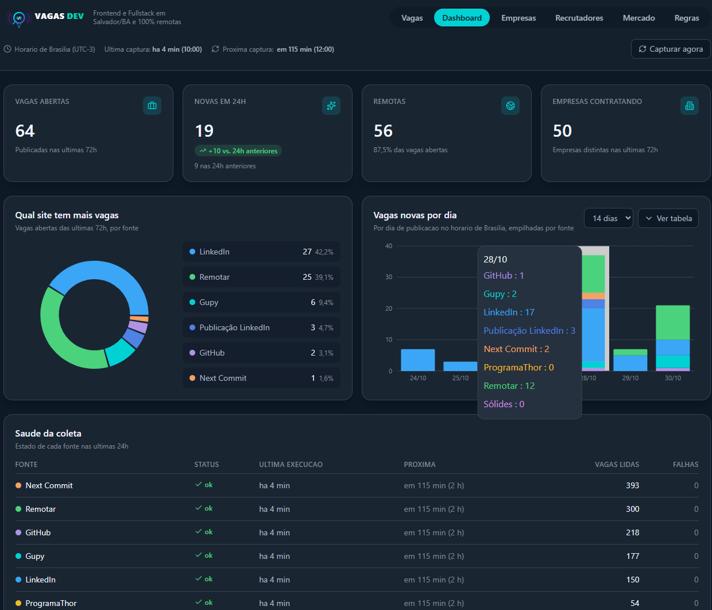

# Vagas Dev

Agregador de vagas para **Desenvolvedor Frontend e Fullstack** em qualquer município da Bahia ou 100% remotas. Coleta de sete fontes a cada 2 horas, descarta o que não é vaga de verdade, deduplica entre plataformas, avisa no Telegram e apresenta tudo em um dashboard analítico.

[](https://github.com/kaiovinic/vagas-dev/actions/workflows/ci.yml)
[](#qualidade)
[](#qualidade)

[](https://www.typescriptlang.org/)
[](https://nestjs.com/)
[](https://react.dev/)
[](https://tailwindcss.com/)
[](https://www.postgresql.org/)
[](https://www.docker.com/)



---

## O problema

Procurar vaga de dev na Bahia significa abrir seis abas por dia, reler os mesmos anúncios e ainda assim perder a vaga publicada às 23h de uma sexta. Pior: boa parte do que uma busca por "React" devolve não é vaga — é curso, bootcamp, divulgação de currículo ou alguém pedindo recolocação.

Este projeto resolve as duas coisas: busca sozinho, e **joga fora o que não é vaga**.

## O produto

### Coletor

Sete fontes ativas. A coluna **lidas** é o que cada uma trouxe numa varredura real, antes de qualquer filtro:

| fonte | como | intervalo | lidas | observação |
|---|---|---|---|---|
| **Next Commit** | HTML paginado por área | 2h | 131 | 44% dos cards batem com a stack |
| **Remotar** | API JSON | 2h | 100 | |
| **GitHub** | issues de `frontendbr/vagas`, `react-brasil/vagas`, `backend-br/vagas` | 2h | 73 | |
| **Gupy** | `__NEXT_DATA__` da busca | 2h | 59 | |
| **LinkedIn** (vagas) | endpoint guest, sem login | 2h | 49 | |
| **ProgramaThor** | HTML | 2h | 18 | |
| **LinkedIn** (publicações) | índice do Google, via [Serper](https://serper.dev) | **4h** | 5 | catálogo exclusivo; exige `SERP_API_KEY` |

Volume não é qualidade: o Next Commit lidera as leituras e as publicações do LinkedIn trazem cinco por ciclo, mas são elas que acham a vaga que não está em portal nenhum.

Três coletores existem, são testados e estão **fora do registro**, cada um por um motivo medido:

- **Jobbol** — o site fica atrás do Bot Management da Cloudflare, que responde `403` a qualquer cliente que não seja navegador. O bloqueio é por impressão digital de TLS: `curl` com o mesmo User-Agent recebe 200, o axios recebe 403.
- **Sólides** — a área de "tecnologia" é suporte e infraestrutura. Das 124 vagas da Bahia, 7 citam a stack e nenhuma estava dentro da janela.
- **Coodesh** — o catálogo real fica atrás de API autenticada; o sitemap público é dominado por vagas de vendas do Google Cloud.

Religar qualquer um é devolver o import e uma linha ao módulo.

#### A data das publicações do LinkedIn

Resultado de buscador **não traz data de publicação**. Sem resolver isso, a única saída seria carimbar o instante da captura — e numa janela de 72h isso erra por horas.

A URL de um post carrega a resposta:

```
linkedin.com/posts/vaz10k_vaga-remota-...-activity-7521210450005594113-7u22
                                                  └──────── snowflake ────────┘
```

Os 22 bits baixos são sequência e nó; o resto é o instante em milissegundos. `Number(BigInt(id) >> 22n)` devolve **28/10/2026 14:05:08** — precisão de segundos, sem uma única requisição ao LinkedIn.

#### Controle de cota

O coletor de publicações é o único que custa dinheiro. Ele roda dentro da captura de 2h, mas se recusa em silêncio fora do seu próprio intervalo de 4 horas:

```
3 consultas por execução  ×  6 execuções/dia  =  18 créditos/dia
2.500 créditos gratuitos  ÷  18              ≈  4 meses e meio
```

São duas buscas separadas — uma de remoto nacional (1 página), outra da Bahia (2 páginas). Separar importa: uma busca única e ampla é dominada pelo mercado remoto, que tem muito mais volume, e a região nunca aparece.

### O funil

O que entra passa por **sete regras**, todas públicas na aba `Regras` com um testador onde você cola um texto e vê qual regra aprovou ou reprovou:

| regra | o que faz |
|---|---|
| Janela de 72h | descarta o que é velho e o que tem data no futuro |
| Stack | exige React, Next.js, TypeScript, Node.js, Angular, C#/.NET ou cargo de desenvolvimento web |
| Localidade | Remoto, ou qualquer município da Bahia |
| Anti-ruído | corta curso, bootcamp, lista de grupo, `#opentowork` |
| Mercado nacional | descarta vaga declaradamente internacional |
| Anúncio de verdade¹ | o texto precisa anunciar uma vaga, não falar sobre vagas |
| Conta agregadora¹ | bloqueia quem republica vaga de terceiros em massa |

¹ valem apenas para publicações de rede social. Um anúncio de portal não precisa dizer "candidate-se" — a página já é o anúncio.

Depois do filtro vêm a **deduplicação**, por fingerprint SHA-256 de `empresa + título` normalizados, e a **classificação** de senioridade e mercado, gravadas em coluna no momento da captura.

Uma captura típica: **439 encontradas → 43 aprovadas**.

### Dashboard analítico

Seis abas: `Vagas`, `Dashboard`, `Empresas`, `Recrutadores`, `Mercado` e `Regras`.

- **KPIs** — vagas abertas, novas em 24h com variação contra as 24h anteriores, remotas (total e percentual) e empresas contratando.
- **Gráficos** — rosca de vagas por fonte e barras empilhadas por dia de publicação, com seletor de período. As sete fontes têm cor fixa, a mesma nos dois gráficos e na tabela de saúde.
- **Filtros** — busca textual, tecnologias, modalidade, senioridade e fonte, mais um recorte temporal de `1h` a `7d`.
- **Saúde da coleta** — uma linha por coletor: estado agora, última execução, próxima, vagas lidas e falhas nas últimas 24h.
- **Split view** — no desktop, feed de cards à esquerda e painel da vaga selecionada à direita; no celular, o mesmo painel abre em drawer.
- **Radar ao vivo** — com o toggle ligado, a lista é reconsultada a cada 60s e um aviso discreto informa quantas vagas chegaram.
- **Cabeçalho de status** — horário da última captura e previsão da próxima, no fuso de Brasília.

#### O recorte de 7 dias

O radar só aceita vaga publicada nas últimas 72h, mas o recorte da lista vai até **168h**. Não é contradição: o chip `7d` mostra o que já foi capturado dentro da janela e envelheceu desde então. Nada mais antigo existe no banco, porque nunca entrou. A badge de idade acompanha — `nova`, `recente`, `1 a 3 dias`, `3 a 7 dias` — com a última faixa apagada de propósito: vaga dessa idade já tem fila de candidatos.

#### Saúde da coleta

O cabeçalho de status responde pelo conjunto, e é aí que ele engana: uma captura `SUCCESS` com 439 vagas encontradas esconde perfeitamente o coletor que não traz nada há um dia. Foi o que aconteceu com o Jobbol, que passou a responder `403` e continuou sendo contado como fonte ativa.

A tabela `capture_source_logs` grava **uma linha por fonte por captura** — `captureId`, `source`, `ranAt`, `totalFound`, `failed` e `errorMessage` — escrita antes do filtro, de modo que `totalFound` é o que a fonte entregou, não o que sobreviveu às regras. A aba `Dashboard` lê dali a última execução, a próxima, as vagas lidas e as falhas das últimas 24h.

O estado tem **três** valores, e não dois:

| estado | significa | quando aparece |
|---|---|---|
| `ok` | a última execução deu certo e a fonte trouxe vagas | caso normal |
| `sem vagas` | respondeu sem erro e voltou de mãos vazias | o caso Jobbol: `200` com catálogo vazio, ou bloqueio silencioso |
| `falha` | a **última** execução falhou | fonte fora do ar, mudança de HTML, timeout |

Dois estados não bastam. Chamar de `ok` quem responde e não traz nada é exatamente o ponto cego que a tabela existe para fechar; chamar de `falha` seria mentira, e um alerta que grita por uma fonte sadia deixa de ser lido. O estado olha a **última** execução, não a média da janela: onze sucessos não salvam a fonte que acabou de quebrar.

#### `source-cadence.ts`, fonte única dos intervalos

Duas camadas precisam saber de quanto em quanto tempo cada fonte é visitada: o coletor de publicações, que se recusa a rodar antes da hora para poupar cota, e a tabela de saúde, que anuncia a próxima execução. Se cada um guardasse o seu número, a tabela mentiria no dia em que o intervalo mudasse.

Por isso o intervalo mora no domínio, em [`source-cadence.ts`](apps/api/src/domain/services/source-cadence.ts):

```ts
sourceIntervalInHours('gupy')            // 2  — ritmo da captura
sourceIntervalInHours('linkedin-posts')  // 4  — espaçado por custo de API
nextSourceRunAt('linkedin-posts', lastRunAt)
```

O provider do LinkedIn deriva seu próprio `LINKEDIN_POSTS_MIN_INTERVAL_HOURS` dessa constante. Mudar a cadência de uma fonte é editar **um** arquivo, e a interface acompanha sozinha.

#### Onde o intervalo é medido

O intervalo diz *quanto* esperar; falta saber *desde quando*. Esse instante vem do banco, não da memória do processo.

A primeira versão guardava o `lastRunAt` num campo do provider, e todo restart da API o zerava: a captura seguinte gastava os 3 créditos por mais recente que tivesse sido a busca anterior. Em desenvolvimento, com a API reiniciando a cada arquivo salvo, isso queimava cota o dia inteiro — e a conta de 4 meses e meio virava ficção.

Hoje o orquestrador pergunta `isDue(reference)` a cada coletor **antes** de visitá-lo, e o de publicações responde comparando o relógio com o último `ranAt` em `capture_source_logs`.

Perguntar antes não é detalhe de implementação: é o que torna a leitura possível. Se a fonte adiada ainda assim fosse registrada no ciclo, o próprio registro do adiamento seria lido como "rodou agora" e a vez dela não chegaria nunca. Fonte adiada não é visitada, não entra na saúde da coleta e não conta para o status da captura — não está falhando nem parada, só não chegou a hora.

### Alertas no Telegram

Cada vaga inédita vira uma mensagem com cargo, empresa, modalidade, mercado, stack e link direto da candidatura:

```
💼 Pessoa Desenvolvedora Frontend React Senior
🏢 Empresa de Teste
📍 Remoto · Salvador/BA · 🇧🇷 Nacional
🔎 Gupy
🏷️ React · TypeScript · Node.js

Ver vaga e se candidatar
```

A API avisa no boot se os alertas estão ligados ou não — um deploy sem token não sobe calado.

**Toda segunda às 08:00** sai também o resumo da semana: vagas abertas, publicadas nos últimos 7 dias, remotas × Bahia e as cinco stacks mais pedidas.

---

## Decisões de arquitetura

### Clean Architecture

Quatro camadas, com a dependência sempre apontando para dentro:

```
domain/        regras de negócio puras — nenhum import de Prisma, Axios ou Nest
application/   casos de uso e orquestração; dependem só de interfaces do domínio
infra/         Prisma, Axios, scrapers, Telegram — implementam as portas
http/          controllers; traduzem HTTP para caso de uso e nada mais
```

O domínio não sabe que existe banco. O caso de uso não sabe que existe Prisma.

### SOLID na prática

- **SRP** — o scraper só busca e normaliza; quem filtra é o `JobRuleEngine`; quem gera o hash é o `JobFingerprint`; quem grava é o repositório.
- **OCP + Strategy nos coletores** — todo coletor implementa `IJobScraperProvider` e é injetado pelo multi-provider `JOB_SCRAPERS`. **Adicionar uma oitava fonte não toca o orquestrador**: basta a nova classe e uma linha na lista do módulo.
- **LSP** — nenhuma implementação lança exceção não tratada: o `BaseScraperProvider` garante que uma fonte fora do ar vire lista vazia, não uma captura quebrada.
- **ISP** — contratos de leitura e escrita são separados (`IJobWriteRepository`, `IDashboardMetricsRepository`, `IJobQueryRepository`, `IMarketInsightsRepository`, `ISourceHealthWriter` × `ISourceHealthRepository`). Quem só lê métrica não enxerga método de escrita — e quem monta a tabela de saúde não tem o que gravar.
- **DIP** — casos de uso dependem de tokens do domínio (`JOB_SCRAPERS`, `TELEGRAM_NOTIFIER`, `CAPTURE_SCHEDULE`), nunca de uma classe concreta de infraestrutura.

### TDD

Teste primeiro, em ciclo Red → Green → Refactor. O domínio e a camada de aplicação têm **100% de cobertura obrigatória**, com o limite aplicado no CI — se cair abaixo, o pipeline falha.

Os coletores são testados contra **fixtures reais**, capturados dos endpoints de verdade, e não contra HTML inventado.

### Controle de concorrência

O cron de 2h e o botão `Capturar agora` compartilham um `CaptureCoordinator` com trava de execução única. Clicar no botão durante uma captura em andamento **não dispara uma segunda** — a chamada se junta à que já está rodando e recebe o mesmo relatório. Sem isso, duas varreduras simultâneas disputariam as mesmas inserções.

### Rate limit do Telegram

A API da Bot aceita cerca de 1 mensagem por segundo no mesmo chat. Uma captura com 18 vagas inéditas dispararia 18 envios no mesmo instante e levaria `429`.

O notificador resolve isso **onde o limite é conhecido** — no adaptador, não em quem chama: uma fila serial encadeada, com 1,1s entre mensagens. Quem usa continua disparando tudo de uma vez; os envios se enfileiram sozinhos. Uma falha no meio não trava as seguintes.

### Fuso horário

Tudo é gravado em UTC e convertido para `America/Bahia` na leitura. Fontes que publicam só a data (sem hora) são ancoradas ao meio-dia de Brasília — ancorar à meia-noite UTC jogaria a vaga para o dia anterior nos gráficos.

---

## Como rodar localmente

**Pré-requisitos:** Node.js 22+ e Docker.

```bash
git clone https://github.com/kaiovinic/vagas-dev.git
cd vagas-dev
npm install
```

**1. Suba o banco**

```bash
npm run db:up
```

**2. Configure o ambiente**

```bash
cp .env.example .env
cp apps/api/.env.example apps/api/.env
```

O Telegram é opcional: sem `TELEGRAM_BOT_TOKEN` e `TELEGRAM_CHAT_ID` a API sobe normalmente e só avisa em `WARN` que os alertas estão desligados. Para ligar, pegue o token com o [@BotFather](https://t.me/BotFather).

**3. Aplique as migrations**

```bash
npm run db:migrate
```

**4. Rode a API e o frontend** (em dois terminais)

```bash
npm run dev:api
```

```bash
npm run dev:web
```

Dashboard em **http://localhost:5173**, API em **http://localhost:3333**.

A primeira captura roda na próxima hora par — ou clique em `Capturar agora` para não esperar.

### Em produção

```bash
cp .env.prod.example .env.prod
docker compose -f docker-compose.prod.yml --env-file .env.prod up -d --build
```

Sobe PostgreSQL com volume persistente, a API (que aplica as migrations no entrypoint antes de servir), o Nginx com os estáticos e o Caddy como proxy reverso, **com certificado TLS emitido e renovado automaticamente**. Só o proxy publica porta; o banco fica em rede sem saída para a internet.

Para subir numa VPS do zero — Docker, DNS, firewall, TLS e backup — o passo a passo está em [`docs/deploy-vps.md`](docs/deploy-vps.md).

Se a VPS já roda outro projeto nas portas 80 e 443, o Caddy do DevRadar vira a borda compartilhada dos dois: [`docs/deploy-vps-compartilhada.md`](docs/deploy-vps-compartilhada.md). Esse guia também cobre o deploy automático: `.github/workflows/deploy.yml` atualiza a VPS por SSH depois que o CI da `main` fecha em verde.

---

## Comandos úteis

| Comando | O que faz |
|---|---|
| `npm run dev:api` | API em watch mode |
| `npm run dev:web` | Frontend em watch mode |
| `npm test` | Todos os testes |
| `npm run test:cov` | Testes com relatório e limites de cobertura |
| `npm run test:int` | Testes de integração (precisa do banco no ar) |
| `npm run lint` | ESLint nos dois workspaces |
| `npm run typecheck` | `tsc --noEmit` nos dois workspaces |
| `npm run build` | Build de produção |
| `npm run db:up` | Sobe o PostgreSQL no Docker |
| `npm run db:migrate` | Aplica as migrations |
| `npm run db:studio` | Prisma Studio |
| `npm run telegram:test --workspace @devradar/api` | Envia uma mensagem de teste ao chat |
| `npm run telegram:digest --workspace @devradar/api` | Dispara o resumo semanal agora |
| `npm run jobs:purge-international --workspace @devradar/api` | Lista (e com `-- --apply` remove) vagas internacionais antigas |
| `npm run jobs:list-unknown --workspace @devradar/api` | Lista as vagas cujo mercado o classificador nao determinou |
| `npm run jobs:reclassify --workspace @devradar/api` | Recalcula o mercado das vagas ja gravadas (`-- --apply` grava) |
| `npm run jobs:analyze --workspace @devradar/api` | Mostra por que cada vaga coletada foi reprovada |

---

## Qualidade

**1.155 testes** unitários e de E2E — 872 na API e 283 no frontend — mais **60 de integração** contra um PostgreSQL real, somando 1.215. Tudo roda em seis jobs no CI a cada push: lint, typecheck, testes com cobertura, testes de integração, build dos workspaces e build das duas imagens Docker.

| Camada | Cobertura | Limite no CI |
|---|---|---|
| `domain/` | 100% | 100% — obrigatório |
| `application/` | 100% | 100% — obrigatório |
| API, total | 96,8% | 95% |
| Frontend | 99,4% | 85% |

O limite não é enfeite: `npm run test:cov` falha abaixo dele, e é esse comando que o CI roda — não o `npm test`. A diferença já custou caro uma vez, quando um controller inteiro passou meses em 0% de cobertura porque o pipeline rodava a versão sem limite.

O ESLint roda com informação de tipo e carrega só regras que pegam o que o compilador não pega — promise solta, `async` usado onde se espera função síncrona, `switch` não exaustivo, dependência faltando em hook. Formatação ficou de fora de propósito.

**Todo coletor é testado contra fixture capturada da fonte real**, nunca contra HTML inventado. A única exceção está marcada no próprio arquivo: `serp-linkedin-posts.json` foi montada a partir do contrato documentado antes de haver chave de API — e depois confirmada contra a resposta de verdade.

Há ainda três comandos de diagnóstico, que existem porque o contador de uma captura não responde o que importa:

| comando | pergunta que responde |
|---|---|
| `jobs:analyze` | por que cada vaga coletada foi reprovada? |
| `jobs:list-unknown` | quais vagas o classificador não conseguiu situar? |
| `posts:probe` | o que a busca do LinkedIn trouxe, e o que o motor achou disso? |

---

## Stack

**Backend** — Node.js, TypeScript strict, NestJS 11, Prisma, PostgreSQL 16, `@nestjs/schedule`, Axios, Cheerio, Zod
**Frontend** — React 19, Vite, TypeScript, Tailwind CSS 4, TanStack Query, React Hook Form + Zod, Recharts, Lucide
**Testes** — Vitest, Supertest, React Testing Library
**Infra** — Docker multi-stage, Docker Compose, Nginx, Caddy, GitHub Actions
